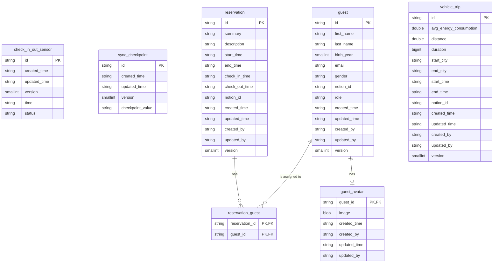

## Database schema

### Table Descriptions

| Table                   | Description                                                                                                      | Type of data  |
|:------------------------|:-----------------------------------------------------------------------------------------------------------------|:--------------|
| **check_in_out_sensor** | Stores sensor data for check-in and check-out events, including timestamps and status.                           | raw           |
| **guest**               | Stores unique guest profiles, including name, contact details, and external identifiers.                         | raw           |
| **guest_avatar**        | Stores the JPEG avatar of a guest (at most one per guest, deleted with the guest).                               | raw           |
| **reservation**         | Stores cabin reservations, including planned start/end times and calculated actual check-in and check-out times. | raw + derived |
| **reservation_guest**   | Links reservations with guests in a many-to-many relationship.                                                   | derived       |
| **sync_checkpoint**     | Stores the last synchronization checkpoints for various data sources.                                            | raw           |
| **vehicle_trip**        | Stores details for all vehicle trips, including consumption, distance, duration, locations, and timestamps.      | raw           |

### Audit columns

`reservation`, `guest`, `guest_avatar` and `vehicle_trip` have four audit columns, in addition to `version` (not on
`guest_avatar`):

| Column         | Required | Set when                                          | Value                                                  |
|:---------------|:---------|:--------------------------------------------------|:-------------------------------------------------------|
| `created_time` | yes      | the row is created, never changed                 | now                                                    |
| `created_by`   | yes      | the row is created, never changed                 | the authenticated user's `guest.id`, or `system`       |
| `updated_time` | no       | an existing row is changed, otherwise null        | now                                                    |
| `updated_by`   | no       | an existing row is changed, otherwise null        | the authenticated user's `guest.id`, or `system`       |

- `system` is used by the vehicle trip import and other tasks. It is not a guest, so there is no foreign key from
  `created_by`/`updated_by` to `guest`; the columns are plain text. Rows that existed when `V1.7` ran have
  `created_by = 'system'`, and `updated_by = 'system'` where `updated_time` was set.
- `created_by` has the database default `system` on `reservation`, `guest` and `vehicle_trip` as a safety net: the
  application always sets the actor explicitly. `guest_avatar` has no default.
- The columns change only when the row is actually changed (an unchanged save does not touch them). `version` and
  `updated_*` of a reservation cover user edits (times, guests) only: check-in/out and vehicle trip links are derived
  data and change neither.
- An avatar's version time (the `v` in `avatarUrl` and the `ETag`) is `updated_time`, or `created_time` when the avatar
  was never replaced. Replacing an avatar changes only the avatar row, not the guest's `version`.
