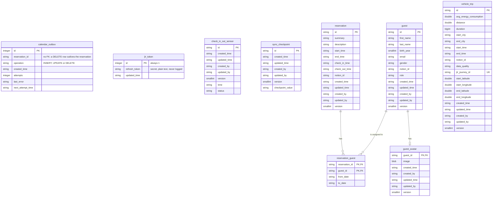

## Database schema

### Table Descriptions

| Table                   | Description                                                                                                      | Type of data  |
|:------------------------|:-----------------------------------------------------------------------------------------------------------------|:--------------|
| **calendar_outbox**     | Pending Google Calendar notifications. A reservation write inserts a row in the same transaction; the row is deleted when it is pushed, so only pending and failing rows stay. Internal, no audit columns. | internal      |
| **check_in_out_sensor** | Stores sensor data for check-in and check-out events, including timestamps and status.                           | raw           |
| **guest**               | Stores unique guest profiles, including name, contact details, and external identifiers.                         | raw           |
| **guest_avatar**        | Stores the JPEG avatar of a guest (at most one per guest, deleted with the guest).                               | raw           |
| **jlr_token**           | The rotating refresh token of the JLR Data Hub login (one row, `id` = 1). A secret kept as plain text, so the DB file and its backups are as sensitive as the private key. Internal, no audit columns. | internal      |
| **reservation**         | Stores cabin reservations, including planned start/end times and calculated actual check-in and check-out times. | raw + derived |
| **reservation_guest**   | Links reservations with guests in a many-to-many relationship. `from_date`/`to_date` (ISO dates, both inclusive) are the guest's own stay when it is shorter than the reservation; null means the guest follows the reservation. | derived       |
| **sync_checkpoint**     | Stores the last synchronization checkpoints for various data sources.                                            | raw           |
| **vehicle_trip**        | Stores details for all vehicle trips, including consumption, distance, duration, locations, and timestamps. Energy, address and city are nullable: see [vehicle_trip](#vehicle_trip). | raw           |

### vehicle_trip

- `duration` is a Kotlin `Duration` stored as nanoseconds (`BIGINT`). `duration_unit` is only a label.
- `avg_energy_consumption(_unit)`, `energy_regenerated`, `energy_generated_unit`, `start_address`, `end_address`,
  `start_city` and `end_city` are nullable. Trips from the JLR Data Hub have no energy values, and no place when the
  lookup fails. Statistics count only trips with energy values, check-in/out ignores trips without start or end city.
- `data_quality` is `COMPLETE` or `PLACE_MISSING` (city or address missing, retried at the next trip fetch). Old rows are
  `COMPLETE`. The name is stored, so a value cannot be renamed without a data migration.
- `jlr_journey_id` is the journey id in the JLR Data Hub (unique, null for trips that only exist in the archive file).
  The four coordinate columns are stored so places can be recomputed.
- The archive import (`addOrUpdate`) never writes `data_quality`, `jlr_journey_id` or the coordinates on an existing row.

### Audit columns

Every table except the internal `calendar_outbox` and `jlr_token` has the same audit columns and `version`:

| Column         | Required | Set when                                          | Value                                                  |
|:---------------|:---------|:--------------------------------------------------|:-------------------------------------------------------|
| `created_time` | yes      | the row is created, never changed                 | now                                                    |
| `created_by`   | yes      | the row is created, never changed                 | the authenticated user's `guest.id`, or `system`       |
| `updated_time` | no       | an existing row is changed, otherwise null        | now                                                    |
| `updated_by`   | no       | an existing row is changed, otherwise null        | the authenticated user's `guest.id`, or `system`       |
| `version`      | yes      | starts at 1, +1 on every change                   | optimistic version                                     |

- In code, `markCreated(actor)` and `markUpdated(actor)` (`common/AuditedEntity.kt`) are the only places that set these
  columns. All tables extend `AuditedIdTable`.
- `system` is used by tasks that no user triggers: the vehicle trip import, the check-in/out sensor sync and the sync
  checkpoints (`check_in_out_sensor` and `sync_checkpoint` always have `system`). It is not a guest, so there is no
  foreign key from `created_by`/`updated_by` to `guest`; the columns are plain text. Rows that existed when `V1.7` ran
  have `created_by = 'system'`, and `updated_by = 'system'` where `updated_time` was set.
- `created_by` has the database default `system` (except on `guest_avatar`) as a safety net: the application always sets
  the actor explicitly.
- The columns change only when the row is actually changed (an unchanged save does not touch them). `version` and
  `updated_*` of a reservation cover user edits (times, guests) only: check-in/out and vehicle trip links are derived
  data and change neither.
- An avatar's version time (the `v` in `avatarUrl` and the `ETag`) is `updated_time`, or `created_time` when the avatar
  was never replaced. Replacing an avatar bumps the avatar's own `version`, not the guest's.
