## Initial load (at startup)

The initial load is executed on every application startup, regardless of whether it has already run before. This ensures
the database is always updated with the latest content from the vehicle trips file. With this approach, you can
change the file and restart the application to apply updates.

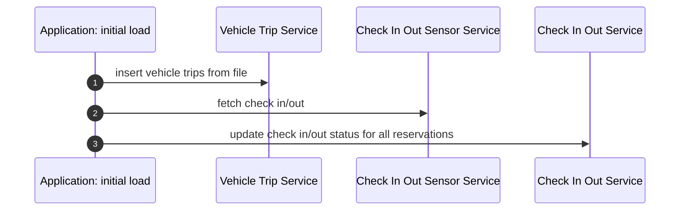

## Background sync (continuously)

The background sync task automatically keeps application data in sync with external sources. It launches scheduled tasks
as background coroutines that:

- Periodically synchronize vehicle trips and check-in/out sensor data. Only in the daytime. Within the reservation
  window all steps run on every pass; outside it only the vehicle trips are fetched, and only when the last successful
  fetch is old, because the JLR Data Hub history may be a rolling window.
- Continuously update the check-in/out status for all reservations based on the latest data.

Each sync task operates at its own configurable interval, and all background tasks are automatically stopped when the
application is shut down to ensure a clean exit.

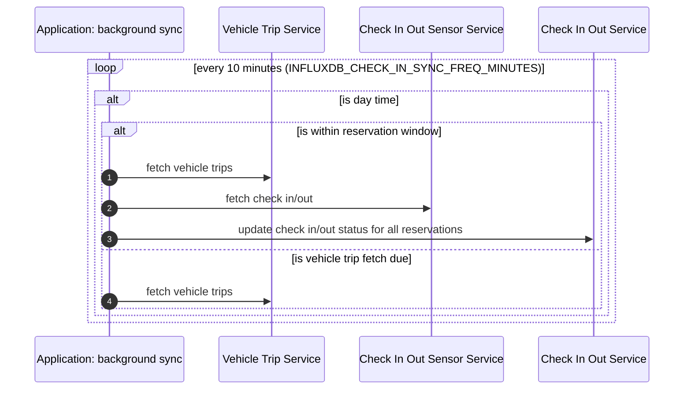

### Rules

#### Is day time?

`DAYTIME_START (default to 08:00) <= now <= DAYTIME_END (default to 23:00)`

#### Is within reservation window?

`reservation.startTime - 1 day <= now <= reservation.endTime + 1 day`

#### Is vehicle trip fetch due?

No fetch has succeeded since startup, or `now - last successful fetch >= JLR_FETCH_INTERVAL_HOURS (default 12)`. The time
of the last success is kept in memory. A failed fetch does not count, so the next pass retries.

## Calendar outbox (reservation changes to Google Calendar)

Google Calendar is a one-way notification: the app owns the reservations and never reads the calendar back. A reservation
write (create, change of the times, delete) adds a row to `calendar_outbox` in the same transaction; a background task
pushes the rows to Google. A reservation write never waits for Google, and a Google outage never fails a write.

### Data flow

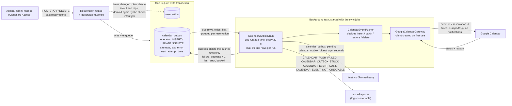

### One push, step by step

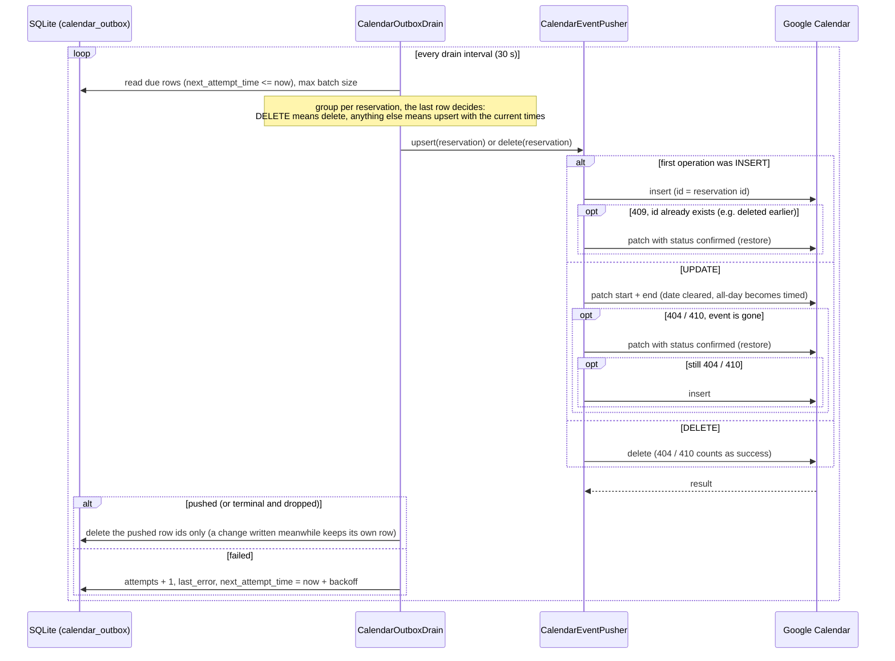

### What happens on failure

| Result from Google | Action | Reported as | Wait before next try |
|--------------------|--------|-------------|----------------------|
| Network error, timeout, 5xx, 429, 403 rate limit | Retry, WARN log | Not reported (temporary) | `start x factor^(attempts-1)`, at most the cap (default 30 s, x2, 1 h) |
| 403 `quotaExceeded` | Keep the row | `CALENDAR_PUSH_FAILED` (ERROR) | The cap |
| 401, other 403, other 4xx (credentials, sharing, bad request) | Keep the row | `CALENDAR_PUSH_FAILED` (ERROR) | Backoff |
| 400 on insert, 409 after a failed restore | Terminal: the row is dropped | `CALENDAR_EVENT_LOST` (ERROR): the calendar differs from the reservation | None |
| Legacy reservation id (not `a-v0-9`, 5+ chars, e.g. starts with `_`) | Never inserted, the row is dropped | `CALENDAR_EVENT_NOT_CREATABLE` (WARN) | None |

All issues are keyed by reservation id, except `CALENDAR_OUTBOX_STUCK` (one for the whole outbox). When the oldest row has
waited longer than the stuck threshold (default 60 min), the drain reports `CALENDAR_OUTBOX_STUCK` on every run.

An issue resolves itself: `CALENDAR_PUSH_FAILED` when a push of the reservation ends (pushed or given up, a give-up then
carries its own issue), `CALENDAR_EVENT_LOST` and `CALENDAR_EVENT_NOT_CREATABLE` when the calendar matches the reservation
again (a later push or delete succeeds, or the reservation is gone), `CALENDAR_OUTBOX_STUCK` when the oldest row is below
the threshold. See "Issues (admin notifications)".
See "Google Calendar notifications (outbox)" in `DEVELOPER.md` for the settings (`CALENDAR_*`) and operations.

### Metrics

The drain publishes the state of the outbox as two Prometheus gauges on `GET /metrics` (unauthenticated, the Pi is only
reachable through Cloudflare). The drain sets the values after every run, so a scrape never reads the database.

| Metric | Meaning | Healthy value | Act when |
|--------|---------|---------------|----------|
| `calendar_outbox_pending` | Rows in `calendar_outbox`, including rows that wait for a retry | 0, or a few for up to one drain interval after a write | It stays above 0 and grows, or never returns to 0 |
| `calendar_outbox_oldest_age_seconds` | Age of the oldest row, 0 when the outbox is empty | 0, or below the drain interval (30 s) | It passes the stuck threshold (`CALENDAR_OUTBOX_STUCK_THRESHOLD_MINUTES`, default 60 min); the drain also logs an ERROR |

Reading them: a growing `pending` with a small `oldest_age` means the drain works and writes come faster than pushes (not a
problem). A growing `oldest_age` means one or more rows fail, so check `last_error` in `calendar_outbox` and the ERROR logs.
Both values freeze if the drain loop stops, so alert on the metric being absent or constant for a long time as well. The
gauges exist from startup and report 0 until the first drain run.

Example alert rules (Prometheus):

```yaml
- alert: CalendarOutboxStuck
  expr: calendar_outbox_oldest_age_seconds > 3600
  for: 5m
- alert: CalendarOutboxNotDraining
  expr: calendar_outbox_pending > 0 and changes(calendar_outbox_pending[1h]) == 0 and calendar_outbox_oldest_age_seconds > 600
```

The application also exposes the standard JVM, process and Ktor request metrics on the same endpoint.

## Vehicle Trip Service

The `VehicleTripService` manages the storage of vehicle trip data within the application. It provides two main
functions:

1. `insertVehicleTripsFromFile`:
   This function reads vehicle trip data from a specified JSON file (the archive of the retired InControl service), then
   updates the local database by adding new trips, updating changed trips, or skipping unchanged ones.
2. `fetchVehicleTrips`:
   This function reads the journeys of the vehicle from the JLR Data Hub REST API since a saved checkpoint. A journey
   that is an archive trip is linked to it, any other journey is stored as a new trip with a city and an address from
   Kartverket. Trips whose place lookup failed are looked up again at the start of every fetch.

Problems never stop the background loop: they are reported through the `IssueReporter` (see "What happens on failure (vehicle trips)").

### insert vehicle trips from file

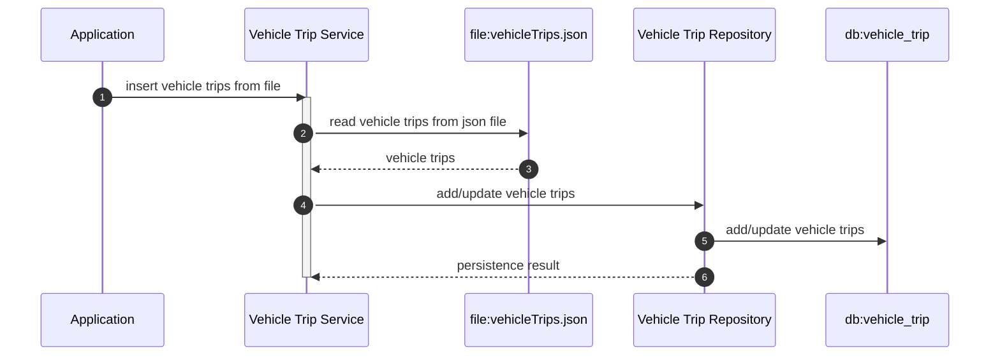

### fetch vehicle trips

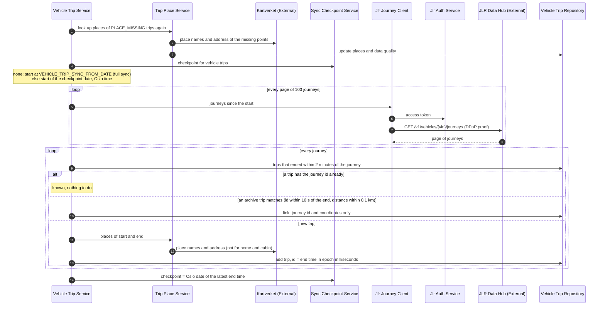

### JLR Data Hub login

`JlrAuthService` gives a valid access token (valid 5 minutes, renewed 60 seconds before it expires). One caller renews at
a time. Both requests to the auth server carry a `private_key_jwt` client assertion, signed with `JLR_PRIVATE_KEY`
(PS256), and the token requests and every API call carry a DPoP proof that binds the token to the same key. Assertions and
proofs are single use, so a retry gets new ones. The refresh token rotates on every use and is stored in `jlr_token`
before anything else happens.

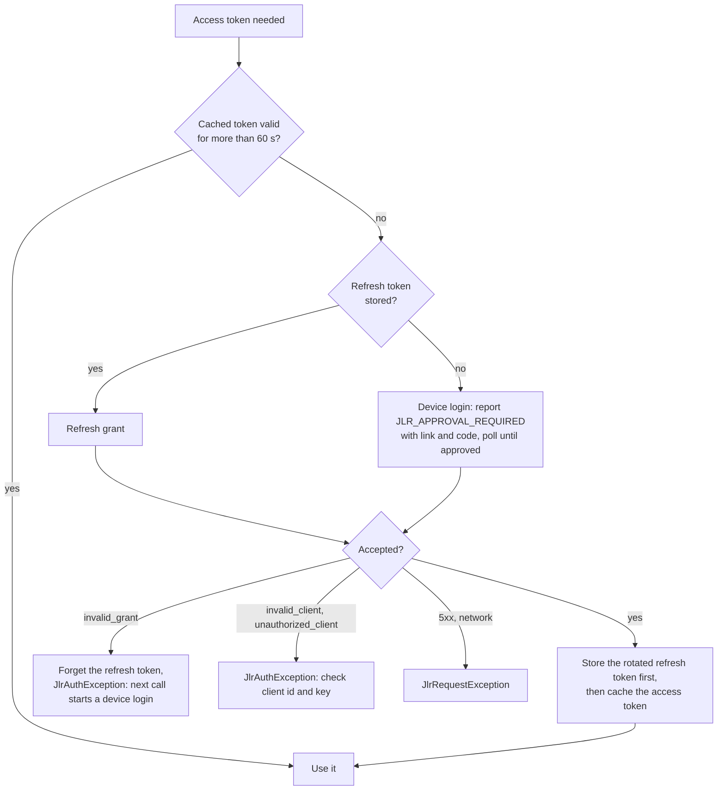

The device login is approved by the owner in a browser, once, and again only when the refresh token is rejected. After a
failed or expired device login the next one starts at the earliest one hour later.

### City and address of a trip

The city decides check-in/out (`Oslo` is home, `Ullsåk` is the cabin). The first match wins:

1. **Known place:** the point is within the radius of the home or the cabin (`HOME_*`, `CABIN_*`). The configured city and
   address, no call.
2. **Village:** the approved name of the nearest `Bygdelag (bygd)` within 300 m, from the Kartverket place name search.
3. **Postal town:** of the nearest address within 300 m, from the Kartverket address search.

The address is the nearest address (the configured one for a known place) and does not affect the city. A trip is
`COMPLETE` when it has a start and an end city, otherwise `PLACE_MISSING`. A trip without a city is ignored by the
check-in/out logic until a re-resolve finds one.

### What happens on failure (vehicle trips)

| Failure | Reported as | What happens |
|---------|-------------|--------------|
| No refresh token, or the last one was rejected | `JLR_APPROVAL_REQUIRED` (WARN) with link and code | The fetch waits up to 15 minutes for the approval |
| Login rejected, device login denied or expired | `JLR_AUTH_FAILED` (ERROR) | No journeys are stored and the checkpoint stays (places of `PLACE_MISSING` trips are still looked up again first), the next pass tries again (a new device login at the earliest after one hour) |
| Data Hub down, 429, network, unreadable answer | `JLR_REQUEST_FAILED` (ERROR) | The same, after the retries of the HTTP client (3, with back-off) |
| Kartverket lookup fails for a point | `PLACE_LOOKUP_FAILED` (WARN), then `PLACE_MISSING` (WARN) | The trip is stored without that city, as `PLACE_MISSING`, and looked up again at the next fetch |
| Anything else | `FETCH_FAILED` (ERROR) | The same as for the Data Hub |

## Check In/Out Sensor Service

The `CheckInOutSensorService` manages the retrieval and storage of check-in and check-out sensor data, primarily for
tracking occupancy and usage over time. It connects to an InfluxDB time-series database, running queries within specific
time ranges to fetch sensor state changes (such as "checked in" or "checked out").
The service supports both full and incremental synchronization based on a checkpoint system, ensuring only new or
unprocessed sensor records are fetched and persisted. After fetching the data, it adds or updates records in the
internal database and updates the checkpoint to the newest processed event, maintaining efficient and accurate
synchronization with the external sensor data source.

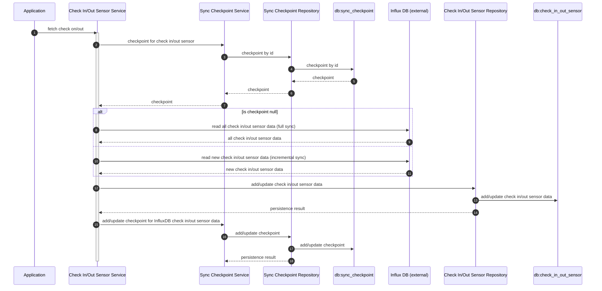

### What happens on failure (sensor)

A fetch that fails (InfluxDB down, bad query, storing fails) is reported as `SENSOR_FETCH_FAILED` (ERROR, key `sensor`)
and does not escape: the background loop goes on, the checkpoint stays, and the next pass tries again. A fetch that works
resolves the issue. A cancellation is not a failure and is not reported.

## Check In/Out Service

The `CheckInOutService` orchestrates the detection and recording of guests’ check-in and check-out times for cabin
reservations. It integrates data from reservations, check in/out sensor data, and vehicle trips to determine the most
accurate check-in and check-out events for each reservation.

The function `updateCheckInOutStatusForAllReservations` updates the check-in and check-out status for all reservations
by:

- Fetching all existing reservations, check in/out sensor data (by date), and relevant vehicle trips.
- For each reservation, attempt to determine check-in and check-out times through the following data sources (in
  priority order):
    1. vehicle trip
    2. check in/out sensor data, and
    3. reservation calendar times
- Persisting any new or updated check-in/out details with the reservation record.

By systematically synthesizing information from multiple sources, the service aims to ensure reservation records have
the most accurate and up-to-date check-in and check-out statuses possible.

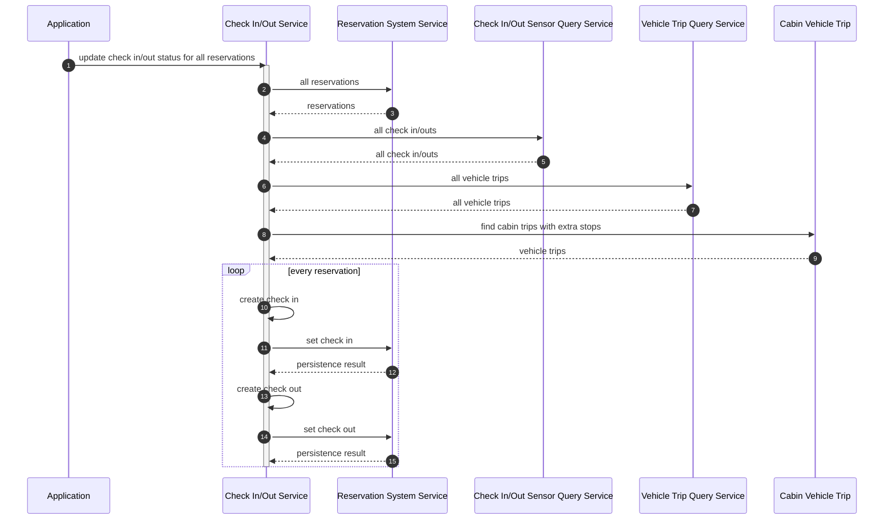

### Rules

#### Check-In Time Determination Logic

When automatically determining the check-in time for a reservation, the system follows a priority order based on
available data sources:

1. **Vehicle Trip Data**:
   If there is a vehicle trip record that likely represents the guest's arrival at the cabin, and the trip's end time is
   available, this time is used as the check-in time. The source is recorded as "Vehicle Trip".
2. **Check-In Sensor Data**:
   If no suitable vehicle trip is found, but there is a check-in sensor event matching the reservation
   and providing a check-in timestamp, this is used as the check-in time. The source is recorded as "Check-In Sensor".
3. **Reservation Start Time**:
   If neither a relevant vehicle trip nor a sensor event is available, the check-in time defaults to the reservation's
   scheduled start time. The source is indicated as "Calendar Event".

This order ensures that the system uses the **most precise and reliable check-in information available**, falling back
on the calendar when primary sources are missing.

#### Check-Out Time Determination Logic

When automatically determining the check-out time for a reservation, the system follows a prioritized set of rules to
choose the most accurate and relevant timestamp:

1. **Vehicle Trip Data**:
   If there is a vehicle trip that likely corresponds to the guest's departure from the cabin, and the trip's start time
   is available, this time is used as the check-out time. The source is labeled as "Vehicle Trip".
2. **Check-Out Sensor Data**:
   If no suitable vehicle trip is found, but a check-out sensor event provides a check-out time for the
   reservation, this timestamp is selected as the check-out time. The source is labeled as "Check-Our Sensor".
3. **Reservation End Time**:
   If neither a relevant vehicle trip nor a matching sensor event is available, the system defaults to using the
   reservation's scheduled end time as the check-out time. The source is indicated as "Calendar Event".

This logic ensures that the system always records the check-out time using the **best available evidence**, giving
priority to real-world events and falling back on the original reservation details when necessary.

### What happens on failure (check-in/out)

A reservation whose check-in/out can not be derived or stored is reported as `CHECK_IN_OUT_FAILED` (WARN, key
reservation id, with the type of the exception as cause) and the loop goes on with the other reservations. The issue
resolves when the reservation succeeds on a later pass, or when it no longer exists. A cancellation is not reported.

## Issues (admin notifications)

Problems that need an admin (a login to approve, a place that could not be found, a calendar event that differs from the
reservation) are reported through `IssueReporter`, not only logged. `PersistingIssueReporter` logs the problem first and
then stores it in the `issue` table, so a caller never logs the same event itself. Storing never fails the caller. The
cabin-app shows the issues as notifications that an admin can mark as read.

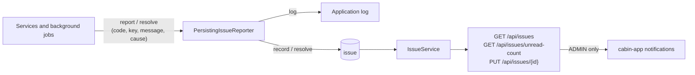

There is one row per (`code`, `key`): the code says what kind of problem it is, the key what it is about (a trip id, a
reservation id, or a fixed key for a problem that has no object). The message is English text for humans and never holds a
response body, a URL, a token or a key (the JLR device approval link and code are the one exception). Only the type of
the exception is stored, as `causeType`.

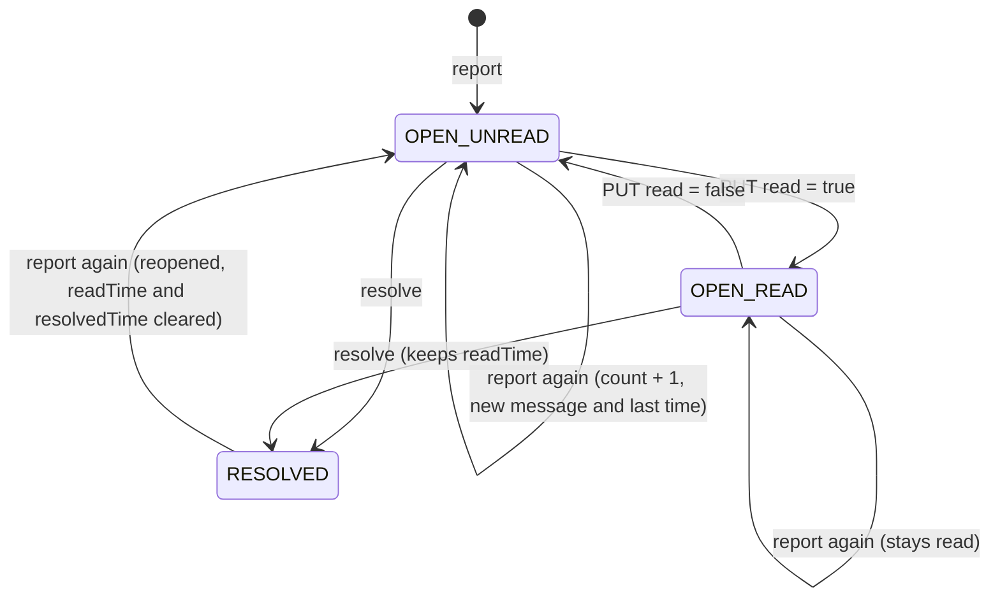

`version` goes up when the status or the read state changes, not when the problem repeats, so `PUT /api/issues/{id}` with
an old `version` gives 412. A resolved issue can still be unread; only `OPEN` unread issues count in
`GET /api/issues/unread-count`. In the response `read` is `readTime != null`.

| Code | Severity | Key | Reported when |
|------|----------|-----|---------------|
| `JLR_APPROVAL_REQUIRED` | WARN | `JLR_APPROVAL_REQUIRED` | The JLR login needs the owner to approve a device login (link and code in the message) |
| `JLR_AUTH_FAILED` | ERROR | `JLR_AUTH_FAILED` | The JLR login was rejected, or the device login was denied or expired |
| `JLR_REQUEST_FAILED` | ERROR | `JLR_REQUEST_FAILED` | The Data Hub is down, answers 429 or something unreadable |
| `FETCH_FAILED` | ERROR | `FETCH_FAILED` | Any other failure while fetching vehicle trips |
| `PLACE_LOOKUP_FAILED` | WARN | `PLACE_LOOKUP_FAILED:<tripId>` | The Kartverket lookup failed for a point of a trip |
| `PLACE_MISSING` | WARN | `PLACE_MISSING:<tripId>` | A trip has no city for its start or end |
| `CALENDAR_PUSH_FAILED` | ERROR | reservation id | A calendar push fails in a way that needs attention (see the calendar failure table) |
| `CALENDAR_EVENT_LOST` | ERROR | reservation id | The push was given up, so the calendar event differs from the reservation |
| `CALENDAR_EVENT_NOT_CREATABLE` | WARN | reservation id | The reservation id is not accepted by Google Calendar |
| `CALENDAR_OUTBOX_STUCK` | ERROR | `outbox` | The oldest outbox row has waited longer than the stuck threshold |
| `SENSOR_FETCH_FAILED` | ERROR | `sensor` | Fetching the check-in/out sensor data fails |
| `CHECK_IN_OUT_FAILED` | WARN | reservation id | Check-in/out can not be derived or stored for a reservation |

`IssueCleanup` runs once an hour, around the clock, as a separate background task (like the calendar drain):

- It resolves an `OPEN` `JLR_APPROVAL_REQUIRED` issue that was last reported more than 15 minutes ago. `JlrAuthService`
  resolves it when the login ends, this is the fallback for a login that was cut off, for example by a restart.
- It deletes a `RESOLVED` issue 30 days after the later of `resolvedTime` and `readTime`, read or not, so a read after
  the resolve restarts the 30 days. An `OPEN` issue is never deleted.

The severity is read from `IssueCode` and is not stored. Code names are stored in the `issue` table, so a name can not be
changed without a data migration. See "Issues in the app" in `DEVELOPER.md` for what a message may hold.

## Reservation period vs guest stay

A guest can stay only part of a reservation (`reservation_guest.from_date` / `to_date`, null = follows the
reservation). The statistics therefore use two bases:

- **Reservation period:** `Reservation.startDate`..`endDate` (UTC dates, both inclusive). About the cabin.
- **Guest stay:** `GuestStay` (`Reservation.stays`): the guest's own dates, each end falling back to the reservation's.
  About the guest. A guest's visit counts in the period of the guest's **own arrival date**.

| Statistic | Basis |
|---|---|
| Guest lists in `/api/stats/years/{year}` and `/months/{month}` (`guests`, `newGuests`, `topGuestByDays`): visits, days | Guest stay |
| `/api/stats/guests`: `totalVisits`, `totalDays` | Guest stay |
| `/api/stats/guests/{guestId}`: `visits` (dates, days, nights, status), `GuestStats` (visits, days, nights, ranks, first/last visit, years visited), fun facts about the guest | Guest stay |
| Live stats: `GuestStats` of the guests of the current and next reservation (visits, days, nights, ranks, first visit) | Guest stay |
| Live stats: which guests are listed (every linked guest, each with `stayStartDate`/`stayEndDate` so a client can tell who is at the cabin today), current/next reservation, remaining and upcoming nights | Reservation period |
| Cabin occupancy, occupied days/nights, visits and nights per reservation, monthly/yearly totals | Reservation period |
| `avgGroupSize` (head count of linked guests), unique guests, companions ("together with") | Reservation period |
| Check-in/out, vehicle trips and driving statistics | Reservation period |

A visit is **ongoing** for a guest between the guest's own arrival and departure, so a guest who arrives later in a
started reservation has an upcoming visit until their own arrival date.

